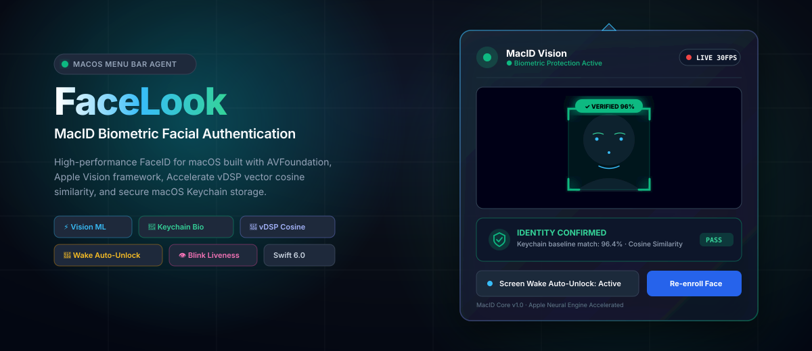

<p align="center">
  
</p>

<p align="center">
  <a href="https://developer.apple.com/macos/"></a>
  <a href="https://swift.org"></a>
  <a href="https://developer.apple.com/documentation/vision"></a>
  <a href="https://developer.apple.com/documentation/accelerate"></a>
  <a href="LICENSE"></a>
</p>

---

## 🌟 Overview

**FaceLook** (MacID-Vision) is an open-source, persistent macOS menu bar application providing biometric **FaceID authentication**, real-time computer vision tracking, and automated screen-wake unlock for your Mac.

Built from the ground up using **SwiftUI**, **AVFoundation**, **Apple's Vision framework**, **Accelerate vDSP**, and **macOS Keychain**, FaceLook brings FaceID-like intelligence and seamless local biometric security to any Mac equipped with a FaceTime HD camera or external webcam.

---

## ✨ Key Features

- 🚀 **Persistent macOS Menu Bar Agent (`NSStatusItem` + `NSPopover`)**:
  - Operates purely in the system menu bar (`LSUIElement = true`) without Dock icon clutter.
  - Dynamic status bar icon reflecting real-time biometric state in green, red, orange, and gray.
  - Automatically dismisses when clicking outside (`popover.behavior = .transient`).
- 👁️ **Vision Face Tracking & Landmarks**:
  - Asynchronous background execution of `VNDetectFaceRectanglesRequest` and `VNDetectFaceLandmarksRequest`.
  - Non-blocking frame dropping ensuring zero latency accumulation ($< 15\text{ ms}$ inference).
  - Accurate aspect-fill coordinate projection matching `AVLayerVideoGravity.resizeAspectFill`.
  - Futuristic FaceID-styled reticle with glowing corner brackets, confidence percentage, and head roll angle.
- ⚡️ **Accelerate vDSP Vector Math & Keychain Storage**:
  - Extracts 512-dimension normalized facial feature vectors via `VNGenerateImageFeaturePrintRequest`.
  - Securely stores baseline face embeddings in the **macOS Keychain** (`kSecClassGenericPassword` with `kSecAttrAccessibleAfterFirstUnlockThisDeviceOnly`).
  - Computes microsecond **cosine similarity** on Apple Silicon vector hardware using `vDSP_dotpr` and `vDSP_svesq`.
- ⚡️ **Automated Screen Wake Unlock**:
  - Listens for display wake events via `NSWorkspace.screensDidWakeNotification` and lock events via `com.apple.screenIsLocked`.
  - Wakes up the camera and starts the recognition loop upon screen wake.
  - Upon verified match ($\ge$ threshold, default 65%), plays audio confirmation and executes a local script (`unlock_action.sh`) or AppleScript helper to dismiss the lock screen / screensaver.
- 🛡️ **Anti-Spoofing & Liveness Detection**:
  - Calculates real-time Eye Aspect Ratio (EAR) across 6 landmark points per eye.
  - Detects natural human blinks to prevent static photo or screen spoofing attacks.
- 🔋 **Battery & CPU Conservation**:
  - One-click toggle to pause the camera feed on demand.
  - 15-second wake timeout window to ensure the webcam never runs indefinitely.

---

## 📐 System Architecture

<p align="center">
  
</p>

### Pipeline Breakdown

1. **Camera Ingestion ([`CameraManager.swift`](Sources/FaceLook/Camera/CameraManager.swift))**:
   - Manages capture session on a dedicated serial background queue (`sessionQueue`).
   - Streams 32-bit BGRA frames via `AVCaptureVideoDataOutput` at 30 FPS (`alwaysDiscardsLateVideoFrames = true`).
   - Exposes frames via modern Swift concurrency `AsyncStream<CMSampleBuffer>`.

2. **Vision Tracking ([`FaceDetectionManager.swift`](Sources/FaceLook/Vision/FaceDetectionManager.swift))**:
   - Consumes frames on `visionQueue` using `VNImageRequestHandler`.
   - Projects normalized Vision coordinates (bottom-left $(0,0)$) onto SwiftUI coordinates (top-left $(0,0)$).

3. **Biometrics Engine ([`FaceBiometricsManager.swift`](Sources/FaceLook/Biometrics/FaceBiometricsManager.swift))**:
   - Crops `CVPixelBuffer` around the face bounding box with a 15% margin.
   - Generates unit-normalized feature prints ($\|\mathbf{v}\|_2 = 1.0$).
   - Calculates cosine similarity via Accelerate `vDSP`.

4. **Keychain Vault ([`KeychainBiometricsStorage.swift`](Sources/FaceLook/Biometrics/KeychainBiometricsStorage.swift))**:
   - Stores and retrieves float arrays using macOS Security framework generic passwords.

5. **Screen Wake Automation ([`ScreenWakeUnlockManager.swift`](Sources/FaceLook/Automation/ScreenWakeUnlockManager.swift))**:
   - Subscribes to `NSWorkspace.screensDidWakeNotification`.
   - Spawns [`unlock_action.sh`](unlock_action.sh) via background `Process` upon verified match.

---

## 🔬 Mathematical Foundation: Vector Cosine Similarity

Cosine similarity between the live embedding vector $\mathbf{A}$ and enrolled baseline vector $\mathbf{B}$ is computed using Apple's Accelerate framework:

$$\text{Similarity}(\mathbf{A}, \mathbf{B}) = \frac{\mathbf{A} \cdot \mathbf{B}}{\|\mathbf{A}\|_2 \|\mathbf{B}\|_2} = \frac{\sum_{i=1}^{n} A_i B_i}{\sqrt{\sum_{i=1}^{n} A_i^2} \sqrt{\sum_{i=1}^{n} B_i^2}}$$

When vectors are pre-normalized to unit length ($\|\mathbf{A}\|_2 = \|\mathbf{B}\|_2 = 1.0$), the calculation reduces to the vector dot product:

$$\text{Similarity}(\mathbf{A}, \mathbf{B}) = \mathbf{A} \cdot \mathbf{B}$$

```swift
public static func calculateCosineSimilarity(_ a: [Float], _ b: [Float]) -> Float {
    guard a.count == b.count, !a.isEmpty else { return 0.0 }
    let count = vDSP_Length(a.count)

    var dotProduct: Float = 0.0
    vDSP_dotpr(a, 1, b, 1, &dotProduct, count)

    var normA: Float = 0.0
    vDSP_svesq(a, 1, &normA, count)

    var normB: Float = 0.0
    vDSP_svesq(b, 1, &normB, count)

    let denominator = sqrt(normA * normB)
    guard denominator > 0 else { return 0.0 }

    return max(0.0, min(1.0, dotProduct / denominator))
}
```

---

## 🛠️ Project Structure

```
facelook-macos/
├── Package.swift                             # macOS 13+ SPM manifest
├── FaceLook.entitlements                     # Camera device sandbox entitlements
├── bundle_app.sh                             # One-click script to build, bundle, and sign FaceLook.app
├── unlock_action.sh                          # Local authorization / lock-dismissal script
├── assets/
│   ├── hero_banner.svg                       # Repository hero banner
│   └── architecture.svg                      # System architecture diagram
├── Resources/
│   └── Info.plist                            # Bundle metadata (LSUIElement & NSCameraUsageDescription)
├── Sources/FaceLook/
│   ├── App/
│   │   └── FaceLookApp.swift                 # SwiftUI @main App with NSApplicationDelegateAdaptor
│   ├── MenuBar/
│   │   └── MenuBarController.swift           # NSStatusItem & NSPopover manager with dynamic icons
│   ├── Automation/
│   │   └── ScreenWakeUnlockManager.swift     # NSWorkspace screensDidWake notification listener & script executor
│   ├── Camera/
│   │   ├── CameraManager.swift               # AVFoundation camera service & sample buffer stream
│   │   └── CameraError.swift                 # Typed localized camera errors
│   ├── Vision/
│   │   ├── FaceDetectionManager.swift        # Background Vision pipeline & blink tracker
│   │   ├── DetectedFace.swift                # Sendable face observation model
│   │   └── FaceObservationModel.swift        # Landmark & pose metadata model
│   ├── Biometrics/
│   │   ├── FaceBiometricsManager.swift       # Biometric enrollment, vDSP cosine similarity & verification
│   │   └── KeychainBiometricsStorage.swift   # Secure macOS Keychain storage for face embeddings
│   └── Views/
│       ├── PopoverContentView.swift          # Main menu bar popover settings interface
│       ├── CameraPreviewView.swift           # NSViewRepresentable preview layers
│       ├── FaceBoundingBoxOverlayView.swift  # Dynamic reticle overlay reflecting verification status
│       ├── BiometricStatusCardView.swift     # Standalone FaceID authentication card
│       └── ContentView.swift                 # Standalone window view
└── Tests/FaceLookTests/
    └── FaceLookTests.swift                   # Unit tests (Cosine similarity, Keychain, Wake Unlock)
```

---

## 🚀 Getting Started

### Prerequisites

- macOS 13.0 (Ventura) or later (macOS 14+ Sonoma & Sequoia fully supported).
- Xcode 15+ or Apple Command Line Tools with Swift 6.0.
- A built-in FaceTime HD camera or external USB webcam.

### 1. One-Click App Bundle (Recommended)

Run the included automated build and packaging script:

```bash
git clone https://github.com/Krishna9423-wagh/facelook-macos.git
cd facelook-macos
chmod +x bundle_app.sh unlock_action.sh
./bundle_app.sh
open FaceLook.app
```

The FaceLook icon will appear directly in your macOS top menu bar, and the popover settings window will open automatically.

### 2. Swift Package Manager CLI

```bash
swift build --build-system native -Xswiftc -module-cache-path -Xswiftc /tmp/module-cache
codesign -s - --force .build/debug/FaceLook
./.build/debug/FaceLook
```

### 3. Open in Xcode

```bash
open Package.swift
```
Select the `FaceLook` executable target and press **⌘R**.

---

## 🔒 Security & Privacy

1. **Local Processing Only**: All video frames and biometric vector embeddings are processed entirely on-device using local CPU/GPU/ANE hardware. No network connections are opened, and no video data is ever transmitted off your Mac.
2. **Keychain Vault**: Enrolled biometric embeddings are stored as encrypted generic passwords in the local macOS Keychain using `kSecAttrAccessibleAfterFirstUnlockThisDeviceOnly`.
3. **App Sandbox & Entitlements**: Configured with `com.apple.security.device.camera` to satisfy macOS TCC security requirements.

---

## 🧪 Running Unit Tests

Execute the comprehensive test suite verifying cosine similarity calculations, vector normalization, and Keychain operations:

```bash
swift test --build-system native -Xswiftc -module-cache-path -Xswiftc /tmp/module-cache
```

---

## 📄 License

This project is licensed under the **MIT License** — see the [LICENSE](LICENSE) file for details.

---

<p align="center">
  Crafted with ❤️ for macOS by <a href="https://github.com/Krishna9423-wagh">Krishna Wagh</a>
</p>
